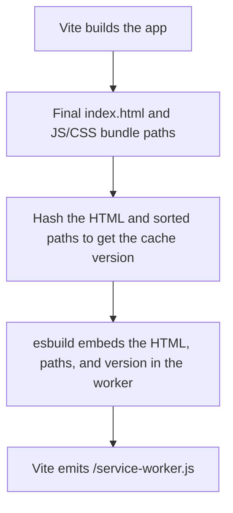
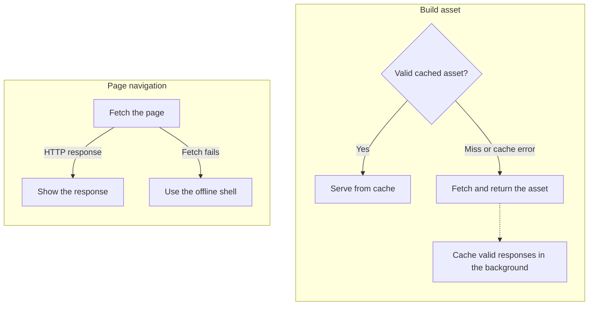
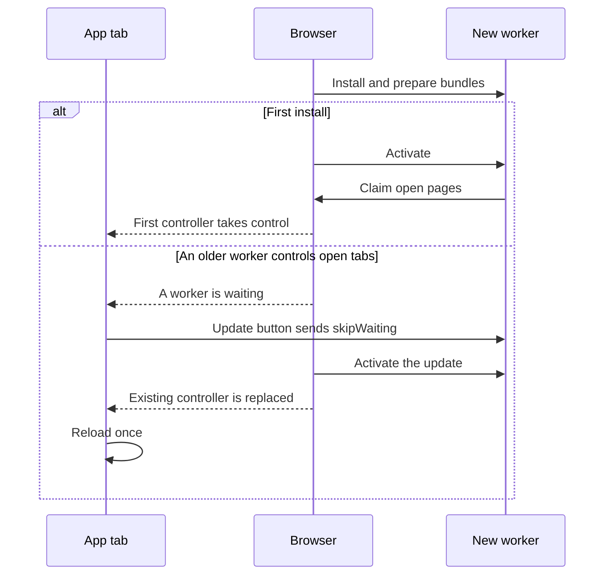

# Photo Companion service worker

Photo Companion's service worker runs in the browser. It loads current pages when the server is reachable and keeps the active build available offline. The offline copy includes the app's starting HTML, called the app shell, and the JavaScript and CSS needed to render its routes.

## What goes into the build

The Vite plugin runs after the final HTML and bundle filenames are available. It passes the HTML, the sorted list of JS and CSS paths, and a version to esbuild, then emits `/service-worker.js` with the rest of the build. The version is a hash of the HTML and bundle paths. Vite puts content hashes in those filenames, so identical build outputs can reuse the same cache. [Build plugin](../../../plugins/compile-service-worker.ts)



When the browser installs the worker, it prepares the bundles for that version, including lazy-loaded pages and translations. It reuses valid entries already in that build's cache. The install succeeds once every required bundle is available and passes the response checks. This lets an installed build render routes the user hasn't opened yet. [Install handler](service-worker.ts)

## How requests are handled

For a page load to a known app route, the worker tries the network first. If the fetch fails, it serves the embedded shell. The router still sees the original URL, so a link like `/sun?latitude=59.93&longitude=30.31` retains its coordinates offline. An HTTP response such as Vercel's `402` goes straight back to the browser. The next page load tries the network again. [App routes](../../shared/consts/index.ts) · [Fetch handler](service-worker.ts)

Both paths below apply to same-origin `GET` requests. A bundle request qualifies when its path is listed in the build, its query is empty, and it asks for the whole file. The browser handles other requests.



The worker checks an asset's HTTP status, redirect flag, and content type before storing or serving it from Cache Storage. This keeps HTML out of the bundle cache, even if a server returns an HTML page with status `200` for a script URL. Cache writes during ordinary loads run in the background so the browser can use the response if storage fails. Public files such as fonts, icons, and the web app manifest use normal browser caching. [Asset handling](service-worker.ts)

Vercel gives fingerprinted files under `/assets/` a long browser cache lifetime, so the browser can reuse them when installing a worker. The SPA rewrite skips asset URLs and file-like paths, which lets missing bundles return a regular `404`. The browser revalidates `/service-worker.js` so it can discover updates. [Vercel configuration](../../../../../vercel.json)

## How updates reach open tabs

On first install, the worker takes control and the page stays open. On later installs, an update can wait while earlier tabs are still running. The app checks for an already waiting worker during registration and watches for new installations. Clicking **Update** tells the waiting worker to activate. Each tab reloads once when its existing controller is replaced. [Registration and update handling](model/service-worker-model.ts)



Activation cleans up caches with the `photo-companion-build-` prefix that were created before the active build's cache. Using the prefix and creation order preserves unrelated caches and caches that a newer installation is preparing. [Cache cleanup](service-worker.ts)

## Try it locally

Run the production build and preview from the repository root. The app registers the worker in production mode.

```sh
pnpm build
pnpm preview
```

1. Open the local URL printed by Vite. In browser DevTools, wait for the service worker to activate.
2. Switch the browser to offline mode and open an unvisited app route such as `/about?latitude=59.93&longitude=30.31`. The page should render with the query still in the address bar.
3. To try an update, go back online and keep two tabs open on the preview origin. Change an app file, rebuild, and use DevTools to check for an update. Click **Update** in the app and check that both tabs reload once.

Run the focused regression tests with `pnpm test:unit service-worker`.
